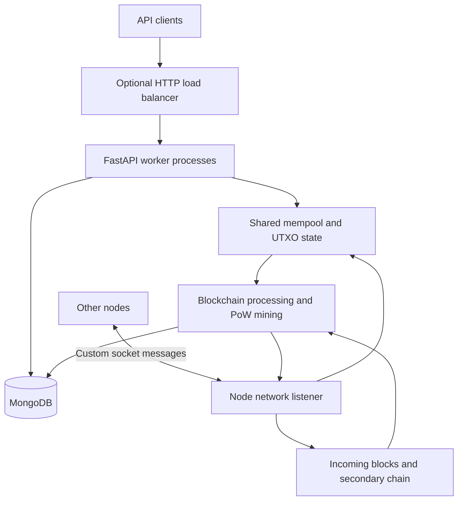

# CryptoBridge

**A blockchain protocol implemented in Python — an independent distributed-systems engineering project.**

[GitHub repository](https://github.com/ArtyomKuteynikov/CryptoBridge)

> **Project status:** CryptoBridge is a long-term independent engineering project. Active development paused after the initial implementation while I focused on other engineering work. I intend to return to the project. The original public network is no longer running; this repository is shared as source code and an engineering reference, not as a live cryptocurrency service.

## Overview

CryptoBridge explores the implementation of a blockchain node from the protocol level, rather than integrating an existing blockchain SDK. The codebase includes a Proof-of-Work chain, UTXO-based transactions, transaction validation, a memory pool, node-to-node messaging, block synchronization, persistent storage, and an optional HTTP API.

The original goal was to make blockchain functionality accessible to external services, including payment and exchange integrations. The repository now also serves as a record of the engineering decisions and trade-offs involved in building these components from scratch.

## Architecture



*Conceptual component diagram based on the repository structure. It is not a claim of a currently deployed network.*

### Core components

| Component | Implementation |
| --- | --- |
| **Consensus and mining** | Proof of Work, nonce search, block-header hashing, difficulty-target handling and periodic adjustment logic |
| **Transactions** | Binary parsing/serialization, multiple inputs and outputs, transaction IDs and signature verification |
| **UTXO model** | Tracking unspent outputs, checking referenced inputs, and rejecting spent inputs during transaction admission |
| **Mempool** | Pending-transaction validation, fee calculation and selection for candidate blocks |
| **P2P communication** | Socket-based messages, peer discovery/handshakes, propagation of transactions and blocks, and synchronization requests |
| **Competing blocks** | Incoming-block queue and secondary-chain data structures for handling alternative chain branches |
| **Persistence** | MongoDB storage for blockchain and node data |
| **HTTP integration** | Optional FastAPI endpoints for blocks, transactions, wallets and nodes; multiple worker processes behind an `aiohttp` load balancer |

## Transaction lifecycle

The intended processing path in the implementation is:

1. A transaction is constructed or received through the API or peer network.
2. The mempool checks its timestamp, referenced UTXOs, input signatures and fee/balance conditions.
3. Valid pending transactions become candidates for inclusion in a mined block.
4. The miner builds a candidate block and searches for a nonce satisfying the Proof-of-Work target.
5. The node processes the resulting block, updates persistent chain state and propagates new block information to peers.
6. Other nodes can request blocks and synchronize their local view of the chain.

This is a description of the implemented processing design, **not** a claim that all edge cases, adversarial scenarios or network partitions have been formally verified.

## Repository structure

```text
CryptoBridge/
├── run.py                    # Node, mining, networking and optional API processes
├── load_balancer.py          # HTTP request distribution
├── pkg/
│   ├── api/                  # FastAPI routes and schemas
│   └── src/
│       ├── blockchain.py     # Main chain-processing and mining logic
│       ├── core/
│       │   ├── block/        # Blocks
│       │   ├── blockheader/  # Headers and Proof of Work
│       │   ├── tx/           # Transactions and coinbase transactions
│       │   ├── utxos/        # UTXO state
│       │   ├── mempool/      # Pending transactions
│       │   ├── script/       # Transaction scripts
│       │   └── secondarychain/ # Alternative chain data
│       ├── network/          # Peer messages and synchronization
│       ├── mongodb/          # Database access
│       └── utils/            # Hashing, encoding and serialization helpers
└── requirements.txt
```

## Technology stack

Python, FastAPI, Uvicorn, `aiohttp`, MongoDB / PyMongo, PyCryptodome, multiprocessing and TCP sockets.

## Running the code

The repository contains the node entry point (`run.py`) and dependency declarations (`requirements.txt`). Its startup configuration is read from `config.ini`, which is **not included in the repository snapshot**. Consequently, the repository should not currently be treated as a turnkey, reproducible deployment.

For local exploration, start by reviewing `run.py` and the modules in `pkg/src/`. A working setup requires MongoDB and a configuration file defining node, database, API and optional parent-peer settings. Do not connect an experimental node to an untrusted network or use it to hold assets of value.

## Current limitations

- The original public network is offline.
- The current source snapshot has not been revalidated with an end-to-end node deployment.
- Automated tests and reproducible local-development setup are not provided in this snapshot.
- The code is an experimental implementation and has not been presented as security-audited or production-ready.

## Future directions

Areas I may revisit as development resumes:

- Reproducible local multi-node setup, example configuration and automated protocol tests
- Peer synchronization, chain reorganizations and robustness under network failures
- A packaged Python client for application integrations
- Additional transaction and wallet capabilities, including the previously explored ideas of shielded wallets, escrow and on-chain tokens

These are **potential future work**, not currently delivered features.

## Why I built it

CryptoBridge was an opportunity to work below the application layer: transaction formats, cryptographic verification, consensus rules, network protocols, concurrent processes and state consistency. The most valuable outcome is the hands-on experience of connecting these pieces into one distributed system—and understanding where correctness and operational complexity become difficult.

## License

See [LICENSE](LICENSE) in this repository.
